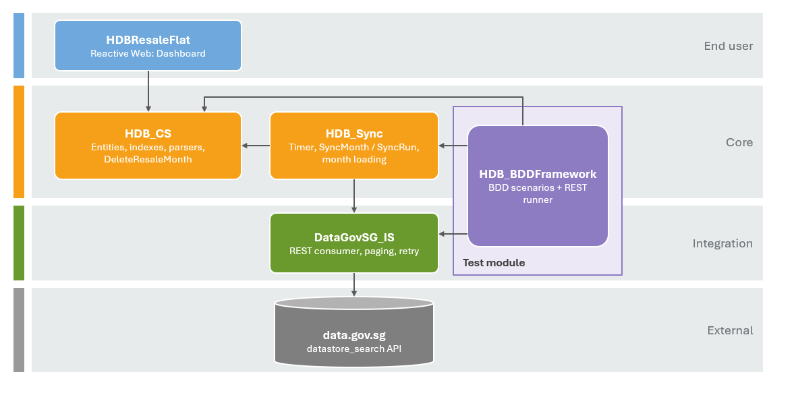

# HDB Resale Price Explorer

An OutSystems 11 application that loads Singapore's HDB resale flat transactions from [data.gov.sg](https://data.gov.sg), keeps a local, analysis-ready copy in sync, and lets users explore prices by town, flat type, period and lease through a dashboard and a filterable transaction grid.

This repository holds the application packages exported from OutSystems, plus the parts of the solution that live outside the OutSystems environment: the automated test runner, the CI workflow and this documentation. The application itself is also published in the OutSystems environment listed below.

| Path | Content |
|---|---|
| [`oml/HDB.oap`](oml/HDB.oap) | Application package: `HDBResaleFlat`, `HDB_CS`, `HDB_Sync`, `DataGovSG_IS` |
| [`oml/HDB_BDDFramework_v3.oml`](oml/HDB_BDDFramework_v3.oml) | Test module with the BDD suites |
| [`scripts/run-bdd-suite.sh`](scripts/run-bdd-suite.sh) | Runs one test suite through the REST runner |
| [`.github/workflows/bdd-tests.yml`](.github/workflows/bdd-tests.yml) | CI workflow |
| [`web/Landing.html`](web/Landing.html) | Source of the start page (deployed as a Resource of `HDBResaleFlat`) |
| [`images/`](images/) | Diagrams used in this README |

---

## Contents

1. [Access](#access)
2. [What the app does](#what-the-app-does)
3. [Architecture](#architecture)
4. [Data pipeline](#data-pipeline)
5. [Data model](#data-model)
6. [Frontend](#frontend)
7. [Key decisions and trade-offs](#key-decisions-and-trade-offs)
8. [Automated testing](#automated-testing)
9. [Security](#security)
10. [Installation and first run](#installation-and-first-run)

---

## Access

| Item | Value |
|---|---|
| Application | [https://personal-brnzrkey.outsystemscloud.com/HDBResaleFlat/Dashboard](https://personal-brnzrkey.outsystemscloud.com/HDBResaleFlat/Dashboard) |
| Application, with start page | [https://personal-brnzrkey.outsystemscloud.com/HDBResaleFlat/Landing.html](https://personal-brnzrkey.outsystemscloud.com/HDBResaleFlat/Landing.html) (shows a loading screen immediately; see below) |
| BDD test runner | `https://personal-brnzrkey.outsystemscloud.com/BDDFramework/rest/v2/BDDTestRunner/HDB_BDDFramework/<Screen>` |
| Test suites (in a browser) | `https://personal-brnzrkey.outsystemscloud.com/HDB_BDDFramework/<Screen>.aspx` |

### First load

The app runs on an OutSystems **Personal Environment**, which is free hosting with these limits:

- **Cold start:** after a period without use, the environment goes to sleep. The first request then takes **30 seconds or more** while the server starts. Later requests are fast.
- **Network latency:** each request takes about 0.3–1 s to start answering from Singapore. A Reactive app loads its JavaScript in several rounds, one after another, so a first visit with an empty cache takes about **12 s** before the dashboard appears. Repeat visits use the browser cache and are much faster.

The app doesn't leave the screen blank for all of that time:

| Phase | What the user sees |
|---|---|
| Platform and module scripts loading (about the first 4 s) | A blank page. The platform generates this page and no app code has run yet. |
| Dashboard scripts loading: OutSystems UI, charts, data grid (about 4–12 s) | A **loading screen** (spinner and "Loading…") added by the module's **On Application Ready** handler. It is removed as soon as the dashboard has rendered. |
| Dashboard rendered | The KPI cards, charts and grid fill in as their data arrives; each loads independently. |

**Start page.** [`Landing.html`](web/Landing.html) covers the first blank phase too. It is a static page deployed as a module Resource, a single small file, so its spinner appears almost immediately. It loads the dashboard in a hidden full-screen frame and fades it in once rendered. The address bar stays on `Landing.html`. If the dashboard can't be shown in a frame, the page redirects to `/HDBResaleFlat/Dashboard`. If the environment is asleep, either URL still waits for it to wake up.

---

## What the app does

**Dataset:** *Resale flat prices based on registration date from Jan-2017 onwards*, about 243,000 transactions as of October 2026, updated daily by HDB.

**For users**, one dashboard page:

- **Filter bar:** town, flat type, and a from/to registration month (defaults to the last 12 months).
- **KPI cards:**
  - *Transactions* for the selected period (shown as e.g. "Oct 2025 – Oct 2026").
  - *Average price:* mean of all resale prices.
  - *Highest price,* with the town, flat type and month of that sale (e.g. "ANG MO KIO · 5 ROOM · Sep 2026").
  - *Price per m²,* weighted by floor area (total price ÷ total floor area).
- **Four charts shown together:**
  - *Price trend by flat type:* average price per m², or median resale price (toggle).
  - *Top 10 towns by median price.*
  - *Remaining lease vs price per m²:* median price per m² by whole years of lease left.
  - *Median price by flat type.*
- **Transactions grid:** every individual sale, paged on the server (50 rows per page), with per-column filtering and sorting.

**Behind the scenes**, a daily Timer keeps the local copy in step with data.gov.sg, month by month, and records every run for auditing.

---

## Architecture

The solution follows the OutSystems Architecture Canvas. Each module has one job, and dependencies only point downwards.



| Module | Type | Responsibility |
|---|---|---|
| `HDBResaleFlat` | Reactive Web | Dashboard screen, chart queries, grid paging and server-side filter/sort builders, loading screen, start page Resource. Theme `HDBResaleFlat`. |
| `HDB_CS` | Service | Entities and indexes; public parsers `ParseStoreyRange` and `ParseRemainingLease`; `DeleteResaleMonth`. |
| `HDB_Sync` | Service | `Timer_SyncResaleData`, sync control entities (`SyncMonth`, `SyncRun`, `Status`), month planning and loading. |
| `DataGovSG_IS` | Service | REST integration with data.gov.sg: `FetchResaleMonth` (a complete month with paging and retries) and `GetMonthTotal` (a month's record count only). |
| `HDB_BDDFramework` | Traditional Web | Automated tests written with BDDFramework, runnable over REST. |

---

## Data pipeline

### Why the data is cached locally

The UI never calls data.gov.sg at request time. A Timer copies the dataset into local tables, and the dashboard queries those.

- **Speed:** medians, rankings and filters over 240k+ rows need SQL and indexes, not an external API.
- **Reliability:** the app keeps working when data.gov.sg is slow, rate-limited or down.
- **Trade-off:** data is at most one day old, which matches how often HDB publishes.

### Daily sync


**`SyncOneMonth`** processes one month as a single unit of work:

1. `DataGovSG_IS.FetchResaleMonth` downloads the **whole** month into memory. It pages through the API, retries failed pages, and returns either the complete month or a failure with a message, never a partial list.
2. `LoadMonth` parses and validates every row and resolves town, flat type and flat model. If **more than 1%** of the rows are invalid, the month is rejected. Otherwise it **deletes the month's existing rows and inserts the new ones**, together with that month's `MonthlyTownStat` rows.
3. The month is marked **Done**, with `RecordCount`, `SourceTotal` (the API's record count) and the reason for any skipped rows, and the transaction is **committed**.
4. On any error the month's work is **rolled back**, so the previous data stays intact. The month is marked **Failed**, `Attempts` is incremented, and the run moves on to the next month.

**Freshness check.** Once a day, `MarkChangedMonths` asks the API for the record count of the current and previous month (one 1-row request each). If the count differs from the stored `SourceTotal`, the month is reloaded in the same run. This picks up late registrations and corrections without downloading unchanged months.

**Backfill.** The first run creates one Pending month for every month since 2017-01 and loads them oldest first. When `MaxRuntimeSeconds` (900 s) is reached, the Timer wakes itself and carries on in a new run. Backfill and the daily refresh use the same code path.

---

## Data model

**Core data** (`HDB_CS`)


**Sync control** (`HDB_Sync`)


- **Parsed at load time.** The API returns most values as text. Storey range (`"10 TO 12"`), remaining lease (`"61 years 04 months"`, `"62 years 01 month"`, `"63 years"`), floor area and lease year are parsed into numbers when they are loaded, so queries never parse text.
- **Indexes on `ResaleTransaction`:** `(TransactionMonth)` for replacing a month, `(TownId, FlatTypeId, TransactionMonth)` for the main filters, and `(FlatTypeId, TransactionMonth)` for comparisons across towns. `Town.Name` is unique.
- **`MonthlyTownStat`** holds pre-computed figures per month × town × flat type for the price-per-m² trend.

---

## Frontend

| Feature | How it is built | Why |
|---|---|---|
| KPI cards | One SQL query (`GetKpis`); the top sale's town, flat type and month come from an `OUTER APPLY (SELECT TOP 1 …)` with the same filters, latest month first on ties | One round trip for all four figures and the top-sale details |
| Price per m² trend | Aggregate over `MonthlyTownStat`, weighted by sales count | Reads thousands of pre-computed rows instead of 240k raw ones; weighting keeps the result a true average for any combination of filters |
| Median trend, town ranking, lease curve, median by flat type | SQL with `PERCENTILE_CONT(0.5)` over `ResaleTransaction` | Medians can't be combined from pre-computed medians, so they are calculated from the raw rows. Small groups are hidden (fewer than 5, 10 or 30 sales) so single sales don't distort the charts |
| Loading screen | The `On Application Ready` system event adds a spinner overlay with inline styles (the theme CSS may not have loaded yet) and removes it once the screen has rendered | Replaces most of the blank page during the first load (see [First load](#first-load)) |
| Chart loading | Each chart has its own data action and loads in parallel; the median trend loads only when that metric is selected | One slow chart doesn't hold up the others |
| Transactions grid | OutSystems Data Grid with **server-side paging** (`OFFSET/FETCH`, `COUNT(*) OVER()`) | The browser only ever holds one page of 50 rows, whatever the size of the dataset |
| Grid filters and sorts | The grid sends its filter and sort *state*; the server builds the `WHERE` / `ORDER BY` from an **allow-list** of columns | Column names never come from the client, and values are escaped or re-parsed (see [Security](#security)) |
| Remaining lease column | Stored as a number (sorts and filters numerically), displayed as `60 years 08 months` by a cell formatter | Correct sorting and readable display |

---

## Key decisions and trade-offs

| # | Decision | Rationale | Trade-off |
|---|---|---|---|
| D1 | **HDB resale dataset (2017 onwards)** | Large and multi-dimensional, so it needs real backend design (ingestion, caching, aggregation) and gives testable business logic. | Older period datasets are not loaded. Before March 2012 they use approval date rather than registration date, which would break trend continuity. |
| D2 | **Local copy synced by a Timer** | Fast queries, independent of the API's availability and rate limits. | Data up to one day old. |
| D3 | **A month is replaced as a whole** (delete and re-insert in one transaction) | Rows have no stable business key: identical sales can occur in the same month, and the datastore `_id` can change. Replacing a month is idempotent and absorbs corrections. | Rewrites a whole month (about 2,000 rows) when anything in it changes. |
| D4 | **Town, flat type and flat model are created on first sight** | A new value in the source never breaks the sync or needs a redeploy. | No compile-time identifiers for these values. |
| D5 | **Pre-computed `MonthlyTownStat`; medians computed live from raw rows** | Medians can't be added up across towns or months, so "all towns" medians come from `PERCENTILE_CONT` over indexed rows. | Median queries are heavier; they are kept to indexed filters and small result sets. |
| D6 | **Paged `datastore_search`, month by month** | One code path for the backfill and the daily refresh. | Slower backfill than the bulk-download API. |
| D7 | **Dataset id in a site property** (`HDB_Sync.DatasetId`) | Keeps the dataset configurable per environment without a config entity nobody needs yet. | Syncing several period datasets would need a small config entity. |
| D8 | **One `Status` static entity** for months and runs | Simple, and no free-text status values. | Month and run statuses share one value list. |
| D9 | **Paging and retries live in `DataGovSG_IS`** | The sync decides *which* months; the integration module decides *how* to fetch them. API changes stay in one module. | — |
| D10 | **Daily sync with a change check** on the current and previous month | The current month is visible from day one, and late registrations are picked up, without re-downloading unchanged months (one 1-row request per month checked). | The current month is incomplete and is shown as such. |
| D11 | **No sync lock** | The platform never runs a Timer concurrently with itself. Manual runs go through Service Center's "Run Now". | Operators must not call the sync action directly. |
| D12 | **Server-side paging and allow-listed filter/sort SQL for the grid** | Scales to any number of rows and keeps SQL construction on the server. | Each new grid column needs an allow-list entry before it can be filtered or sorted. |
| D13 | **Server-side BDDFramework tests with a REST runner** | Tests the real logic and database behaviour, and can be called from CI. | Tests run against a published environment, not in isolation. |

---

## Automated testing

Tests live in the `HDB_BDDFramework` module. Each screen is a test suite of Given / When / Then scenarios, and each suite can be run over REST:

```
GET https://personal-brnzrkey.outsystemscloud.com/BDDFramework/rest/v2/BDDTestRunner/HDB_BDDFramework/<Screen>
```

The response includes `IsSuccess`, pass/fail counts and per-scenario results.

| Suite | Kind | What it covers |
|---|---|---|
| `ParserTests` | Unit | Storey range and remaining lease parsing, including `"62 years 01 month"`, `"63 years"`, `"61 years 12 months"` (invalid) and malformed input |
| `MonthlyStatsTests` | Unit | Odd-count median (400k/450k/500k/550k/900k → 500k), even-count median (→ 525k), min, max, count, average price per m², one row per town × flat type |
| `SyncMonthTests` | Integration | Loading a month twice gives the same result; a reload replaces rows; more than 1% invalid rows is rejected and existing data kept; town names are normalised |
| `SyncPlanningTests` | Integration | Months are created up to and including the current month; month creation is idempotent; failed months are retried only while attempts are below 3 |
| `DataGovApiTests` | Contract | A real month is fetched with records; an unknown dataset id fails cleanly with a message |

**Test data:** integration tests use fixture months in 1900 (no real data exists there). Each scenario's teardown deletes its fixtures and commits, so tests can run against a populated environment.

### CI (GitHub Actions)

[`.github/workflows/bdd-tests.yml`](.github/workflows/bdd-tests.yml) calls the runner for each suite through [`scripts/run-bdd-suite.sh`](scripts/run-bdd-suite.sh). A suite fails the build unless it answers HTTP 200 with `IsSuccess: true`.

| Job | Suites | When |
|---|---|---|
| Unit and integration | `ParserTests`, `MonthlyStatsTests`, `SyncMonthTests`, `SyncPlanningTests` | Every push and pull request to `main`; on demand |
| Contract | `DataGovApiTests` (calls the live data.gov.sg API) | Nightly at 03:30 SGT, after the sync Timer; on demand with *include contract* ticked |

- **One suite at a time.** The integration suites share fixture months, so they never overlap. A concurrency group also stops two workflow runs from testing the same environment at once.
- **Results.** Each suite's JSON response is uploaded as a build artifact, and a pass/fail table is written to the run summary.
- **Setup:** add a repository **variable** `OUTSYSTEMS_BASE_URL` (`https://personal-brnzrkey.outsystemscloud.com`) under *Settings → Secrets and variables → Actions*.

**Run a suite locally** (needs `curl` and `jq`):

```bash
OUTSYSTEMS_BASE_URL=https://personal-brnzrkey.outsystemscloud.com bash scripts/run-bdd-suite.sh ParserTests
```

**Limitation:** a Personal Environment has no LifeTime deployment pipeline, so CI tests what is already published rather than deploying first. With LifeTime, the workflow would deploy the tagged version to a test environment and then run the same suites.

---

## Security

| Topic | Approach |
|---|---|
| Grid SQL | The only SQL built at runtime is the grid's `WHERE` / `ORDER BY`. Column names come from a server-side **allow-list**. Text values are escaped (`EncodeSql`, plus escaping of `LIKE` wildcards). Numbers and dates are parsed and written back out, so raw input never reaches SQL. Unknown columns become `1=0`. Sorting accepts only `ASC` / `DESC`, with `Id` as a tie-breaker. |
| API key | Stored in a **secret** site property in `DataGovSG_IS`. Never stored in code or in this repository. |
| Test runner | BDDFramework's REST runner is unauthenticated, and test screens allow anonymous access. **Intended for non-production environments only**; in production, the test module is not deployed. |
| Third-party code | `DisableClientSideFiltering` relies on a private field of the Data Grid's Wijmo filter (`grid.features.filter._filter`). It must be re-checked when the Data Grid component is upgraded. |

---

## Installation and first run

The application is already published in the environment under [Access](#access). To install it in another OutSystems 11 environment, use the packages in [`oml/`](oml/).

**Prerequisites** (install from Forge first, if the environment does not have them):

- OutSystems UI, OutSystems Charts, OutSystems Data Grid, OutSystems Maps
- BulkInsert and Sleep (used by the sync and the integration)
- BDDFramework (only for the test module)

**Install, in this order**

1. **`oml/HDB.oap`**: in Service Studio, *Environment → Open Files…*, select the file and confirm the install. This publishes `HDB_CS`, `DataGovSG_IS`, `HDB_Sync` and `HDBResaleFlat` as one application.
2. **`oml/HDB_BDDFramework_v2.oml`**: open it in Service Studio and publish (*1-Click Publish*). It depends on the modules from step 1, so publish it only after the application package.

**Site properties**

| Module | Property | Default | Purpose |
|---|---|---|---|
| `DataGovSG_IS` | `APIKey` (secret) | — | data.gov.sg API key |
| `DataGovSG_IS` | `PageSize` | 50 | Rows per API request |
| `DataGovSG_IS` | `RequestDelayMs` | 1000 | Pause between page requests |
| `DataGovSG_IS` | `MaxRetries` | 3 | Attempts per page before giving up |
| `HDB_Sync` | `DatasetId` | — | data.gov.sg dataset id to sync |
| `HDB_Sync` | `MaxRuntimeSeconds` | 900 | Time budget per Timer run before it continues in a new run |

**First run**

1. Install the packages as described above (or, from source, publish in order: `HDB_CS` → `DataGovSG_IS` → `HDB_Sync` → `HDBResaleFlat` → `HDB_BDDFramework`).
2. In Service Center, set `DataGovSG_IS.APIKey` and `HDB_Sync.DatasetId`.
3. Set `Timer_SyncResaleData` to run **daily** (for example 03:00 SGT).
4. Start the first run with **Run Now**. The backfill continues across several runs on its own.
5. Follow progress in the `SyncMonth` and `SyncRun` tables, or in the Timer log in Service Center.
6. Run the BDD suites through the runner URL.

